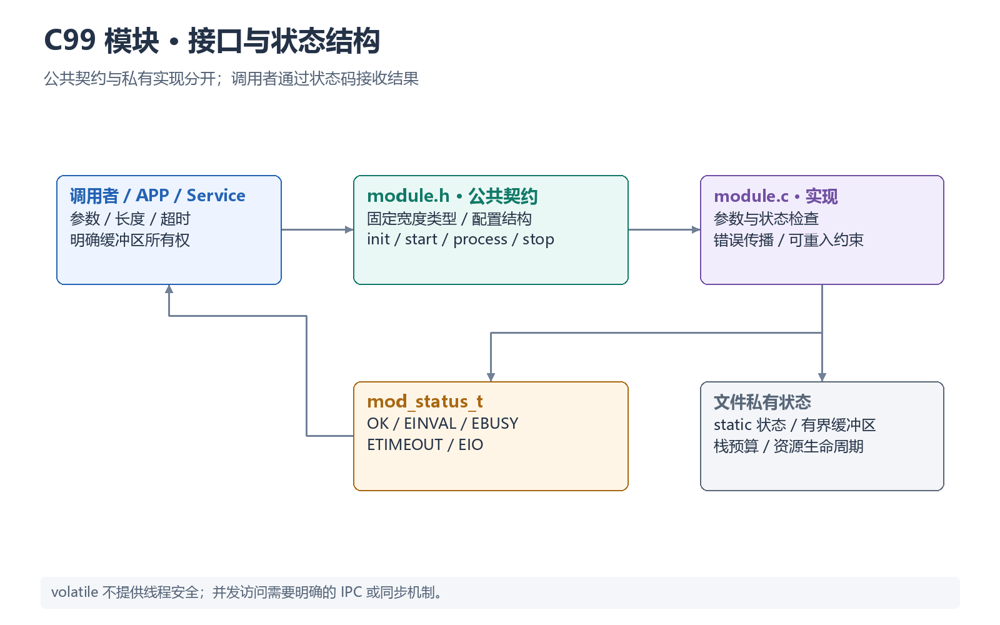

# 嵌入式 C99 实现规范



## 基本规则
- 协议、寄存器、硬件边界使用 `stdint.h` 固定宽度类型。
- 公共 API 必须有模块前缀；`.h` 只暴露真正契约。
- 文件内部状态优先 `static`；禁止无约束的可写 `extern` 全局变量。
- `volatile` 只表示访问不可被优化，不等于线程安全。
- 禁止 ISR 中阻塞、`printf`、动态分配和复杂业务。
- 避免 VLA、递归和大局部数组；Task 栈必须有预算。
- 所有输入检查空指针、长度、范围和状态。
- Magic number 进入 `enum`/`const`/配置文件。

## 模块模板
```c
typedef enum {
    MOD_OK = 0,
    MOD_EINVAL,
    MOD_EBUSY,
    MOD_ETIMEOUT,
    MOD_EIO
} mod_status_t;

mod_status_t mod_init(const mod_config_t *cfg);
mod_status_t mod_start(void);
mod_status_t mod_process(void);
mod_status_t mod_stop(void);
```

## AI 写代码时
先确定：谁拥有状态、谁分配缓冲区、谁释放/归还、函数可否在 ISR 调用、是否可重入、超时策略、错误传播路径。不要只给“能编译”的代码。
