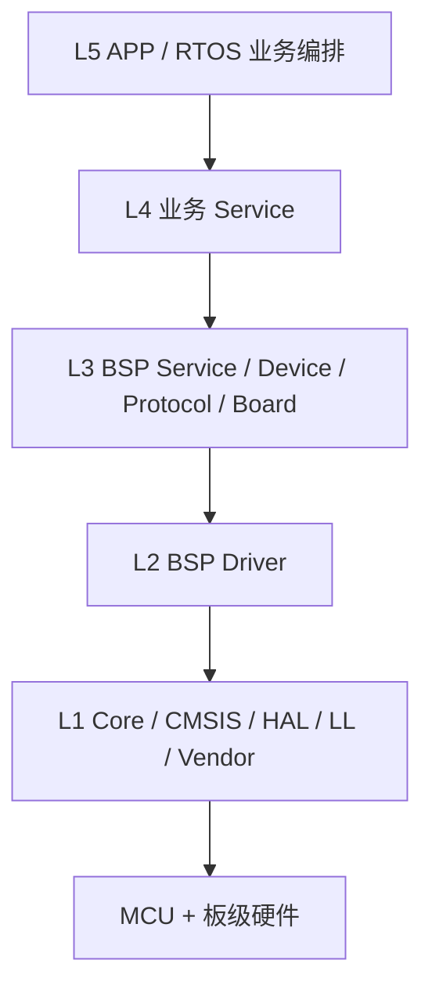
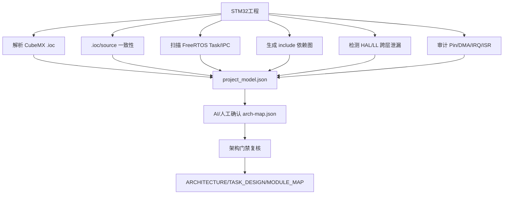
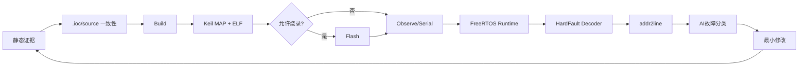

# V0.4 中文版：架构与自动调试模型

## 固件五层架构


横向基础设施：
```text
Middlewares/  FreeRTOS / FatFs / LVGL / lwIP
Common/       CRC / RingBuffer / math / utils
Config/       board/app/feature 配置
Tests/        单元 / 集成 / HIL
```

## AI 工程理解流程


## V0.4 自动调试闭环


## 证据层次

```text
静态事实
  .ioc / include / HAL leak / IRQ / DMA / architecture

编译产物
  Build log / Keil MAP / ELF

运行事实
  Serial / RTT / SWO / ITM / GDB
  FreeRTOS Task / Stack HWM / Heap

CPU Fault
  CFSR / HFSR / BFAR / MMFAR / PC / LR / xPSR
  addr2line → source:line
```

安全规则：默认不自动烧录；没有证据时不宣称问题已经定位；工具只负责采证和复核，不替代芯片参考手册与真实硬件测量。
